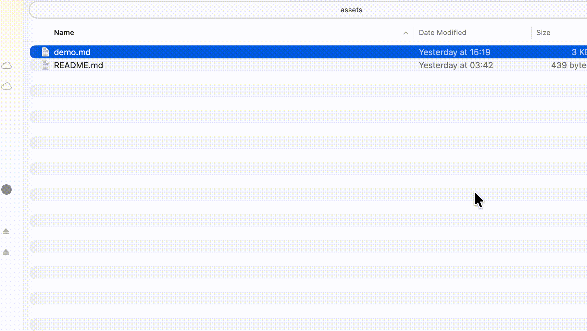

# FluxMarkdown

<p align="center">
  <em>Beautiful Markdown previews in macOS Finder QuickLook</em><br>
  Mermaid • KaTeX • GFM • TOC • Charts • Export
</p>

<p align="center">
  <a href="https://github.com/xykong/flux-markdown/stargazers">
    
  </a>
  <a href="https://github.com/xykong/flux-markdown/releases">
    
  </a>
  <a href="https://github.com/xykong/flux-markdown/releases">
    
  </a>
  <a href="LICENSE">
    
  </a>
</p>

<p align="center">
  <a href="README.md">English</a> •
  <a href="README_ES.md">Español</a> •
  <a href="README_ZH.md">中文文档</a> •
  <a href="#-quick-install-30-seconds">Install</a> •
  <a href="#-troubleshooting">Troubleshooting</a>
</p>

## Privacy and network activity

Markdown rendering uses bundled local assets. The app also checks for updates and, by default, sends pseudonymous usage statistics. You can turn off **Share Usage Statistics** in Settings (for both the app and Quick Look). Statistics do not include document names, paths or contents. See the [privacy notice](docs/PRIVACY.md) for the collected fields, IP-based location processing, retention and opt-out behavior.

---

## ✨ Demo



<p align="center">
  <strong>Press <code>Space</code> in Finder → Instant preview with diagrams, math, and more.</strong>
</p>

<p align="center">
  <em>👋 If FluxMarkdown helps you, consider giving it a</em>
  <a href="https://github.com/xykong/flux-markdown/stargazers">⭐ star on GitHub</a>!
</p>

---

## 🚀 Quick Install (30 seconds)

### Homebrew (Recommended)

```bash
brew install --cask xykong/tap/flux-markdown
```

If Homebrew reports that `xykong/tap` is not trusted, this is Homebrew's third-party tap trust warning, not a FluxMarkdown install failure. Prefer trusting only this cask:

```bash
brew trust --cask xykong/tap/flux-markdown
brew install --cask xykong/tap/flux-markdown
```

See [Tap Trust](https://docs.brew.sh/Tap-Trust) for Homebrew's security model.

### Manual (DMG)

1. Download the latest `FluxMarkdown.dmg` from [Releases](https://github.com/xykong/flux-markdown/releases)
2. Open the DMG
3. Drag **FluxMarkdown.app** to **Applications**

---

## 💡 Why FluxMarkdown?

| Feature | Description |
|---------|-------------|
| 📊 **Mermaid Diagrams** | Architecture diagrams, flowcharts, sequence diagrams |
| 🧮 **KaTeX Math** | Inline and block mathematical expressions |
| 📝 **GFM Support** | Tables, task lists, strikethrough, and GitHub Alerts |
| 🎨 **Code Highlighting** | Syntax highlighting for 40+ languages |
| 📊 **Charts & Graphs** | Vega, Vega-Lite, and Graphviz (DOT) support |
| 📑 **TOC Panel** | Interactive table of contents with section tracking |
| 📄 **YAML Metadata** | Auto-parses frontmatter into a clean table |
| 📤 **Export** | PDF (Cmd+Shift+P) / HTML (Cmd+Shift+E) — V2EX 用户求的功能！ |
| 🔍 **Zoom & Pan** | Cmd +/-/0, Cmd+scroll, pinch gestures |
| 💾 **Position Memory** | Remembers scroll position and last-viewed file |
| 🌓 **Themes** | Light, Dark, and System-synchronized modes |
| 📂 **File Formats** | Supports .md, .mdx, .rmd, .qmd, .mdoc, .mdc, .mmd, .livemd, .mkd, .mkdn, .mkdown, .mdwn, .mdown, .markdown, and read-only .tsv table previews |

---

## ⚙️ Settings (Cmd+,)

FluxMarkdown includes a dedicated Settings window to customize your experience:

- **Appearance**: Switch between Light, Dark, or System themes.
- **Rendering**: Toggle Mermaid, KaTeX, or Emoji support.
- **Editor**: Adjust base font size and choose code highlighting themes (GitHub, Monokai, Atom One Dark, etc.).

---

## ⌨️ Keyboard Shortcuts

| Shortcut | Action |
|----------|--------|
| `Space` | Open QuickLook preview (Finder) |
| `Cmd` + `+` / `-` / `0` | Zoom in / out / reset |
| `Cmd` + `Shift` + `E` | Export as HTML |
| `Cmd` + `Shift` + `P` | Export as PDF |
| `Cmd` + `,` | Open Settings |

---

## 🛠️ Troubleshooting

<details>
<summary><strong>"App is damaged" / "Unidentified developer"</strong></summary>

Run this in Terminal:
```bash
xattr -cr "/Applications/FluxMarkdown.app"
```
</details>

<details>
<summary><strong>QuickLook not showing updates</strong></summary>

Reset QuickLook cache:
```bash
qlmanage -r
```
</details>

<details>
<summary><strong>Preview not working at all</strong></summary>

1. Check if the app is in `/Applications/`
2. Try restarting Finder: `killall Finder`
3. Check `pluginkit -m -v` for active QuickLook extensions
</details>

**📚 More help:** See [`docs/user/TROUBLESHOOTING.md`](docs/user/TROUBLESHOOTING.md) and [`docs/user/AUTO_UPDATE.md`](docs/user/AUTO_UPDATE.md)

**📖 Documentation index:** [`docs/README.md`](docs/README.md)

---

## Comparison (QuickLook Markdown plugins)

| Feature | FluxMarkdown | [QLMarkdown](https://github.com/sbarex/QLMarkdown) | [qlmarkdown](https://github.com/whomwah/qlmarkdown) | [PreviewMarkdown](https://github.com/smittytone/PreviewMarkdown) |
| --- | --- | --- | --- | --- |
| Install | brew cask / DMG | brew cask / DMG | manual | App Store / DMG |
| Mermaid | Yes | Yes ([ref](https://github.com/sbarex/QLMarkdown/blob/main/README.md#mermaid-diagrams)) | Not mentioned | Not mentioned |
| KaTeX / Math | Yes | Yes ([ref](https://github.com/sbarex/QLMarkdown/blob/main/README.md#mathematical-expressions)) | Not mentioned | Not mentioned |
| GFM / Alerts | Yes | Yes (cmark-gfm; [ref](https://github.com/sbarex/QLMarkdown/releases/tag/1.0.18)) | Partial (Discount; [ref](https://github.com/whomwah/qlmarkdown#introduction)) | Not mentioned |
| TOC panel | Yes | Not mentioned | No | Not mentioned |
| Charts (Vega/DOT) | Yes | Not mentioned | No | No |
| Export (PDF/HTML) | Yes | No | No | No |
| YAML Frontmatter | Yes | Yes | No | No |
| Themes | Light/Dark/System | CSS-based ([ref](https://github.com/sbarex/QLMarkdown/blob/main/README.md#extensions)) | Not mentioned | Basic controls ([ref](https://github.com/smittytone/PreviewMarkdown#adjusting-the-preview)) |
| Zoom | Yes | Not mentioned | No | Not mentioned |
| Scroll restore | Yes | Not mentioned | No | Not mentioned |

> Notes:
> - Entries are based on public README/release notes at the cited links.
> - If a feature isn't mentioned in sources, we mark it as "Not mentioned".

---

## Build from source

```bash
git clone https://github.com/xykong/flux-markdown.git
cd flux-markdown
make install
```

## 📄 License

**FluxMarkdown is dual-licensed:**

### Open Source License: GPL-3.0
- ✅ **Free** for personal, educational, and open-source use
- ✅ Any modifications must also be open-sourced under GPL-3.0
- 📜 See [`LICENSE`](LICENSE) for full terms

### Commercial License
- 💼 Required for **closed-source** or proprietary products
- 💼 Allows distribution without open-sourcing your modifications
- 📧 Contact: **xy.kong@gmail.com** for licensing inquiries
- 📜 See [`LICENSE.COMMERCIAL`](LICENSE.COMMERCIAL) for details

**Why dual licensing?** This ensures FluxMarkdown remains free and open for the community while allowing commercial use without GPL obligations for those who need it.

---

<p align="center">
  <sub>Inspired by and partially based on <a href="https://github.com/shd101wyy/markdown-preview-enhanced">markdown-preview-enhanced</a></sub>
</p>

### Reporting a failure

Error notices offer a recovery action and **Report This Problem**. Reporting opens
GitHub with the selected error and available system information already filled in;
you review and publish the issue there. A GitHub account is required. Use **Review
Feedback…** to add optional details or turn off diagnostics before continuing.

Reports exclude document text, file paths and raw system logs by default. If the
browser cannot open, the report remains available to copy or save. **Help → Review
Last Error…** reopens the latest failure, and **Help → Clear Error History** clears
locally retained error records without changing your settings. Errors controlled
by macOS itself, or failures where the extension never starts, may require the
existing **Help → Report an Issue** entry.

### TSV table previews

Open `.tsv` in FluxMarkdown or preview it with Finder Quick Look. UTF-8 (including BOM) and LF/CRLF/CR records are supported. Tabs separate columns; quotes, HTML, Markdown and formulas remain literal text. The first record is data, with generated column numbers above it.

Previews show up to 500 KiB, 1,000 rows, 100 columns and 20,000 cells. Truncation is marked in the table, source view and exports. Empty fields and uneven rows are preserved. This is a read-only viewer, not a spreadsheet editor; quoted multiline fields and non-UTF-8 encodings are not supported. On initial host-app opening, macOS supplies a full FileDocument buffer before the app decodes its bounded prefix; very large initial opens can still use significant memory.
